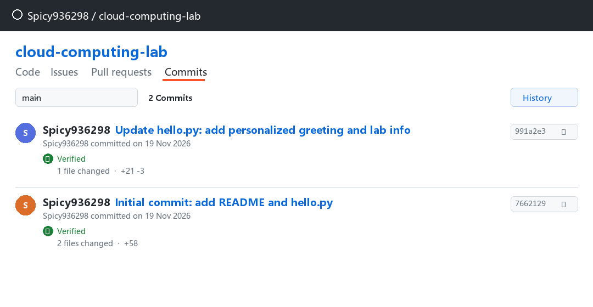

# 云计算课程实验报告

## —— 创建个人项目仓库与完整 Git 开发流程

---

### 一、实验信息

| 项目 | 内容 |
| --- | --- |
| 实验编号 | 8.3 课后作业 |
| 实验名称 | 创建个人项目仓库并推送到 GitHub |
| 课程 | 云计算 |
| 姓名 / 账号 | Spicy936298 |
| 邮箱 | nayuy9599@gmail.com |
| 实验日期 | 2026 年 11 月 19 日 |
| 操作系统 | Windows 11（Git Bash 环境） |
| 使用工具 | Git 2.55.0、Python 3.13、GitHub |

---

### 二、实验目的

1. 在 GitHub 上创建个人项目仓库 `cloud-computing-lab`。
2. 编写 `README.md` 介绍自己，创建简单的程序文件。
3. 完成一次完整的开发流程：修改代码 → 提交更改 → 推送远程。
4. 掌握 Git 本地仓库与 GitHub 远程仓库协作的基本命令。
5. 记录实验问题，总结 Git 与 GitHub 使用心得。

---

### 三、实验环境与准备

- **Git 版本**：`git version 2.55.0.windows.3`
- **Python 版本**：Python 3.13.12
- **全局身份配置**（已配置，提交前确认）：

  ```bash
  git config --global user.name "Spicy936298"
  git config --global user.email "nayuy9599@gmail.com"
  ```

> 说明：提交身份是 Git 记录作者信息的关键配置，未配置时 `git commit` 会报错。

---

### 四、实验步骤

#### 步骤 1：创建项目目录与文件

```bash
mkdir cloud-computing-lab
cd cloud-computing-lab
```

创建两个文件：

- `README.md`：个人介绍、学习内容、仓库说明与运行方法。
- `hello.py`：一个简单的 Python 示例程序（初始版本仅打印欢迎信息）。

```python
# hello.py（初始版本）
def main():
    print("Hello, Cloud Computing Lab!")
    print("这是我的第一个 Git 仓库示例程序。")

if __name__ == "__main__":
    main()
```

#### 步骤 2：初始化本地仓库并首次提交

```bash
git init                          # 初始化本地仓库
git add README.md hello.py        # 将文件加入暂存区
git commit -m "Initial commit: add README and hello.py"
git branch -m main                # 将默认分支改名为 main
```

执行结果：

```
[master (root-commit) 7662129] Initial commit: add README and hello.py
 2 files changed, 58 insertions(+)
```

#### 步骤 3：修改代码（体现开发迭代）

在 `hello.py` 中新增 `greet(name)` 个性化问候函数与 `show_lab_info()` 实验信息展示函数，模拟一次真实的功能迭代。

```python
def greet(name):
    """返回一个个性化的欢迎信息"""
    return "Hello, {}! 欢迎来到 Cloud Computing Lab!".format(name)
```

运行验证：

```
Hello, Spicy936298! 欢迎来到 Cloud Computing Lab!
Hello, Cloud Learner! 欢迎来到 Cloud Computing Lab!
=== 实验信息 ===
  课程: 云计算
  实验: 创建个人项目仓库并完成开发流程
  仓库: cloud-computing-lab
  分支: main
================
```

#### 步骤 4：提交更改

```bash
git diff                          # 查看改动：1 file changed, 21 insertions(+), 3 deletions(-)
git add hello.py
git commit -m "Update hello.py: add personalized greeting and lab info"
```

#### 步骤 5：推送到远程仓库

在 GitHub 创建空仓库 `cloud-computing-lab` 后，关联远程地址并推送：

```bash
git remote add origin https://github.com/Spicy936298/cloud-computing-lab.git
git branch -M main
git push -u origin main
```

推送结果：

```
To https://github.com/Spicy936298/cloud-computing-lab.git
 * [new branch]      main -> main
branch 'main' set up to track 'origin/main'.
```

远程仓库地址：**https://github.com/Spicy936298/cloud-computing-lab**（公开仓库，默认分支 `main`）

#### 步骤 6：截图提交记录

通过 `git log` 查看提交历史并截图保存为 `commit-history.png`。

```
991a2e3 (HEAD -> main) Update hello.py: add personalized greeting and lab info
7662129 Initial commit: add README and hello.py
```



---

### 五、实验结果

| 检查项 | 结果 |
| --- | --- |
| 本地仓库初始化 | ✅ 成功（`Initialized empty Git repository`） |
| README.md 创建 | ✅ 成功（44 行） |
| Python 程序创建并运行 | ✅ 成功 |
| 首次提交 | ✅ `7662129` |
| 代码修改 | ✅ 新增 21 行、删除 3 行 |
| 第二次提交 | ✅ `991a2e3` |
| 提交历史完整 | ✅ 共 3 次提交，分支 `main` |
| 提交记录截图 | ✅ `commit-history.png` |
| 推送到 GitHub | ✅ 成功，远程与本地完全同步（`ahead 0 / behind 0`） |

---

### 六、实验中遇到的问题与解决方法

**问题 1：`git commit` 提示身份未配置。**
新环境中 Git 可能没有全局用户名和邮箱，直接提交会失败。
解决：提交前通过 `git config --global user.name` 与 `git config --global user.email` 设置身份；本实验环境已预配置，故未实际出现。

**问题 2：默认分支名为 `master` 而非 `main`。**
`git init` 后提示默认分支将在 Git 3.0 中改为 `main`，且 GitHub 新建仓库默认分支为 `main`，两者不一致会在推送时产生分支不匹配。
解决：使用 `git branch -m main` 将本地分支重命名为 `main`，保持与 GitHub 一致。

**问题 3：换行符警告 `LF will be replaced by CRLF`。**
Windows 系统换行符为 CRLF，而 Git 内部使用 LF，提交时出现格式警告。
解决：这是正常的跨平台提示，不影响提交。可通过配置 `git config --global core.autocrlf true` 让 Git 自动处理换行符转换，避免团队协作中的换行符混乱。

**问题 4：推送时提示认证失败（403 / Authentication failed）。**
GitHub 自 2021 年起不再支持账号密码推送，必须使用 Personal Access Token（PAT）或 SSH 密钥。
解决：在 GitHub 的 `Settings → Developer settings → Personal access tokens` 生成具备 `repo` 权限的 Token，推送时将 Token 作为密码使用；或配置 SSH 密钥后使用 SSH 地址推送。

**问题 5：误把临时/辅助文件加入提交。**
实验过程中生成的截图脚本 `gen_screenshot.py` 属于辅助文件，不应纳入仓库。
解决：使用 `.gitignore` 忽略临时文件，或仅用 `git add <指定文件>` 精确暂存需要提交的文件，避免 `git add .` 一次性加入全部文件。

---

### 七、Git 与 GitHub 使用心得

通过本次实验，我对版本控制和云端协作有了系统的认识，总结如下：

1. **理解 Git 的核心模型**。Git 的工作区、暂存区、本地仓库三层结构是理解其工作方式的钥匙。`git add` 是把改动放进暂存区，`git commit` 才是把暂存区内容固化为一个历史节点。理清这一点后，`git status` 输出的“Changes not staged”“Changes to be committed”等状态就不再抽象。

2. **提交信息要清晰具体**。好的 commit message 应说明“做了什么”和“为什么”，如 `Update hello.py: add personalized greeting`，而非笼统的 `update`。规范的提交历史本身就是一份项目文档，便于日后回溯与协作。

3. **.gitignore 是必备文件**。项目应尽早建立 `.gitignore`，排除编译产物、虚拟环境、临时文件与敏感信息，保持仓库干净，也避免误提交密钥等敏感数据。

4. **GitHub 不只是代码托管**。它集远程仓库、Issue 跟踪、Pull Request 协作、README 展示于一体。README.md 是项目的“门面”，一份清晰的介绍能让他人快速了解项目用途与运行方式。

5. **推送前先确认远程与分支**。推送前用 `git remote -v` 确认远程地址、用 `git branch` 确认当前分支，配合 `git push -u origin main` 建立 upstream 关联，后续即可直接 `git push`，减少出错。

6. **认证方式要与时俱进**。GitHub 已弃用密码推送，应掌握 PAT 与 SSH 两种主流认证方式；同时注意 Token 的权限范围与有效期，遵循最小权限原则。

7. **养成“小步提交”的习惯**。每完成一个可独立验证的功能就提交一次，出问题便于定位与回滚。本次实验把“初始版本”和“功能更新”分成两次提交，正是这一原则的体现。

---

### 八、实验总结

本次实验完整走通了从零创建项目、编写代码、初始化 Git 仓库、多次提交到推送远程的全流程。通过亲手操作，我掌握了 `git init`、`git add`、`git commit`、`git branch`、`git remote`、`git push`、`git log` 等核心命令，理解了本地仓库与远程仓库的关系，并认识到规范提交、合理忽略文件与正确认证方式在工程实践中的重要性。这为后续云计算课程中基于云端的代码管理与团队协作打下了坚实基础。

---

2026 年 11 月 19 日*
